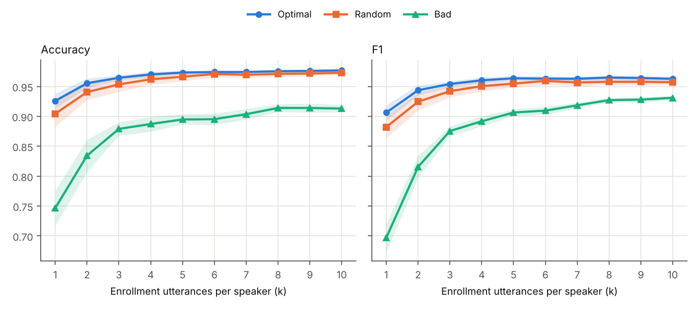
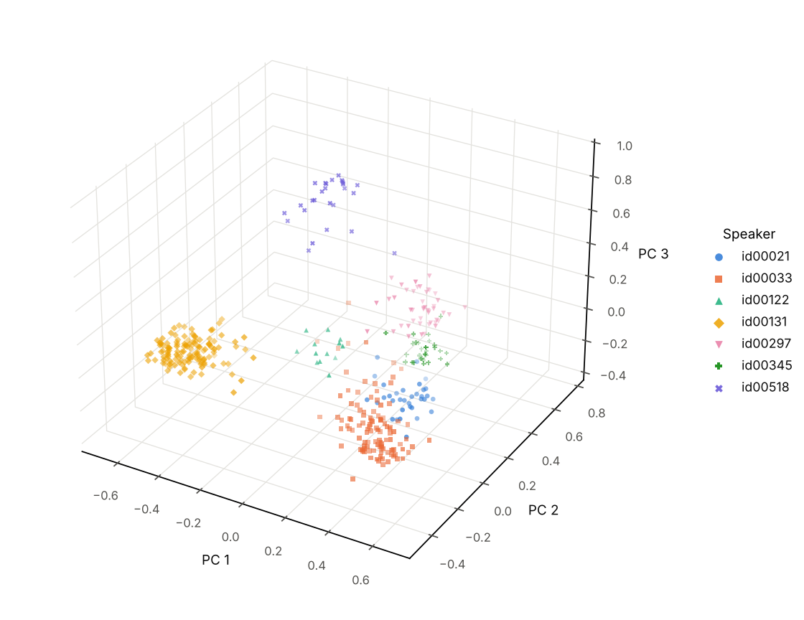
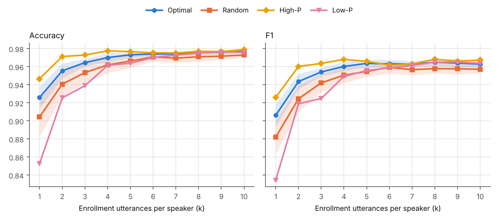
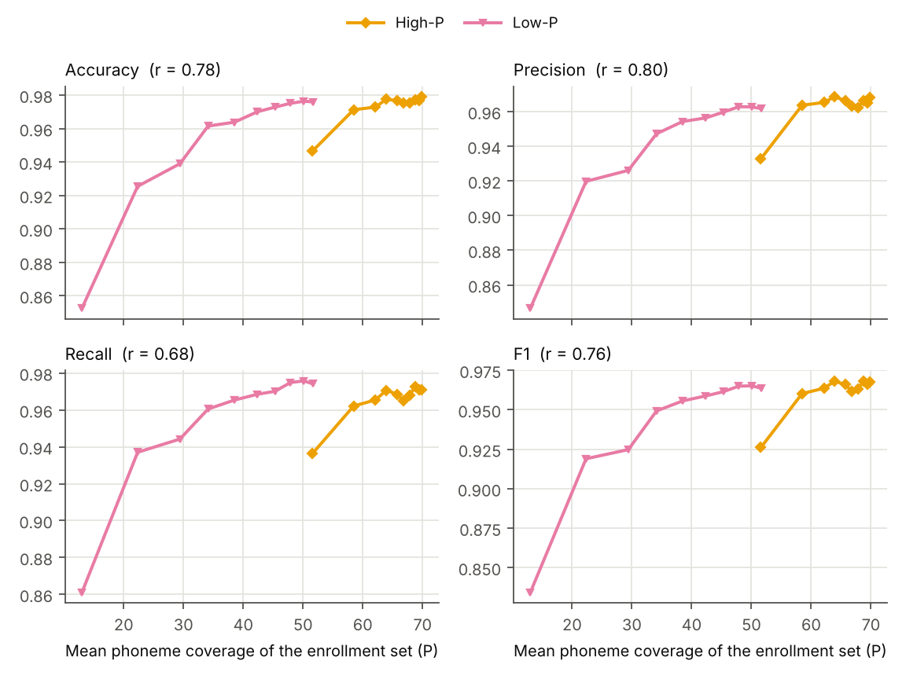
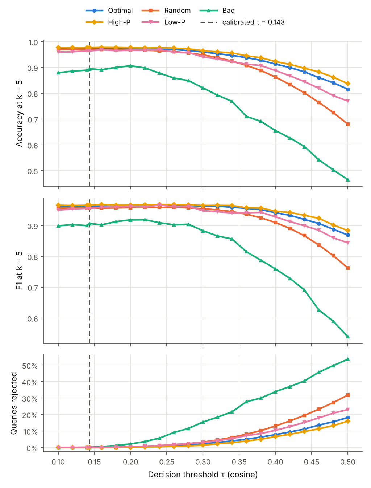

# Reproduced results

Results reproduced with this repository (speaker-enrollment 1.0.0) using `configs/vietnam_celeb.yaml`; generated on 2026-10-24.

## Setup

| Item | Value |
|---|---|
| Test set | 57 speakers, 4,154 utterances |
| Validation set | 50 speakers, 509 utterances |
| Speaker encoder | ECAPA-TDNN, `ecapa_tdnn_vietnam_celeb.model` (SHA-256 `af01bb9dcb87…`) |
| Embeddings | whole utterances, one forward pass each; computed on `mps` |
| Decision threshold τ | 0.1432: equal-error-rate point of the validation pairs (EER 11.29%) |
| Test EER (reference) | 4.53% over all utterance pairs; 4.54% over the trial list (1,074,357 trials) |
| Selection | candidate rule `clique`, scoring `mean`, quality check `pairwise`; 30 random draws per configuration and k |
| Metrics | accuracy; precision, recall and F1 per test speaker, macro-averaged; rejected queries count as errors |
| Software | speaker-enrollment 1.0.0, Python 3.11.15, PyTorch 2.14.1, macOS-26.6.2-arm64-arm-64bit |

## Similarity-based enrollment selection (ICPRAM 2025 experiment)

Identification of the 57 test speakers with k enrollment utterances per speaker. Optimal is the method proposed in ICPRAM 2025, Random the baseline and Bad the control; mean ± standard deviation over 30 random draws.

### Bad case

| k | Accuracy | Precision | Recall | F1 |
|---:|---:|---:|---:|---:|
| 1 | 0.747 ± 0.029 | 0.719 ± 0.028 | 0.747 ± 0.017 | 0.697 ± 0.024 |
| 2 | 0.834 ± 0.027 | 0.845 ± 0.016 | 0.853 ± 0.012 | 0.815 ± 0.018 |
| 3 | 0.879 ± 0.011 | 0.895 ± 0.010 | 0.908 ± 0.006 | 0.875 ± 0.008 |
| 4 | 0.887 ± 0.012 | 0.907 ± 0.007 | 0.925 ± 0.006 | 0.892 ± 0.009 |
| 5 | 0.895 ± 0.009 | 0.925 ± 0.006 | 0.937 ± 0.004 | 0.906 ± 0.006 |
| 6 | 0.895 ± 0.010 | 0.927 ± 0.005 | 0.940 ± 0.004 | 0.910 ± 0.007 |
| 7 | 0.904 ± 0.009 | 0.934 ± 0.003 | 0.946 ± 0.004 | 0.918 ± 0.005 |
| 8 | 0.914 ± 0.007 | 0.939 ± 0.002 | 0.954 ± 0.003 | 0.927 ± 0.004 |
| 9 | 0.914 ± 0.008 | 0.941 ± 0.002 | 0.954 ± 0.004 | 0.928 ± 0.004 |
| 10 | 0.913 ± 0.006 | 0.942 ± 0.002 | 0.958 ± 0.002 | 0.931 ± 0.004 |

### Random case

| k | Accuracy | Precision | Recall | F1 |
|---:|---:|---:|---:|---:|
| 1 | 0.904 ± 0.022 | 0.889 ± 0.017 | 0.902 ± 0.014 | 0.882 ± 0.018 |
| 2 | 0.941 ± 0.013 | 0.929 ± 0.013 | 0.939 ± 0.011 | 0.924 ± 0.015 |
| 3 | 0.954 ± 0.012 | 0.944 ± 0.007 | 0.954 ± 0.007 | 0.942 ± 0.010 |
| 4 | 0.962 ± 0.009 | 0.952 ± 0.007 | 0.962 ± 0.006 | 0.951 ± 0.009 |
| 5 | 0.966 ± 0.007 | 0.955 ± 0.005 | 0.965 ± 0.004 | 0.955 ± 0.006 |
| 6 | 0.971 ± 0.005 | 0.959 ± 0.006 | 0.968 ± 0.004 | 0.959 ± 0.007 |
| 7 | 0.970 ± 0.005 | 0.957 ± 0.005 | 0.968 ± 0.005 | 0.957 ± 0.006 |
| 8 | 0.971 ± 0.005 | 0.957 ± 0.005 | 0.969 ± 0.004 | 0.958 ± 0.005 |
| 9 | 0.972 ± 0.004 | 0.957 ± 0.005 | 0.969 ± 0.004 | 0.958 ± 0.006 |
| 10 | 0.973 ± 0.003 | 0.957 ± 0.004 | 0.971 ± 0.003 | 0.957 ± 0.004 |

### Optimal case

| k | Accuracy | Precision | Recall | F1 |
|---:|---:|---:|---:|---:|
| 1 | 0.926 ± 0.012 | 0.908 ± 0.012 | 0.921 ± 0.010 | 0.906 ± 0.013 |
| 2 | 0.955 ± 0.008 | 0.944 ± 0.008 | 0.954 ± 0.007 | 0.944 ± 0.009 |
| 3 | 0.965 ± 0.004 | 0.954 ± 0.004 | 0.962 ± 0.004 | 0.954 ± 0.005 |
| 4 | 0.970 ± 0.005 | 0.960 ± 0.005 | 0.967 ± 0.004 | 0.960 ± 0.005 |
| 5 | 0.973 ± 0.003 | 0.963 ± 0.004 | 0.970 ± 0.003 | 0.964 ± 0.004 |
| 6 | 0.974 ± 0.003 | 0.962 ± 0.004 | 0.970 ± 0.004 | 0.963 ± 0.005 |
| 7 | 0.974 ± 0.002 | 0.962 ± 0.003 | 0.970 ± 0.003 | 0.963 ± 0.003 |
| 8 | 0.976 ± 0.003 | 0.963 ± 0.004 | 0.972 ± 0.003 | 0.965 ± 0.004 |
| 9 | 0.976 ± 0.002 | 0.962 ± 0.004 | 0.972 ± 0.003 | 0.964 ± 0.004 |
| 10 | 0.977 ± 0.002 | 0.961 ± 0.004 | 0.971 ± 0.003 | 0.963 ± 0.003 |

### Orderings

Enrollment sizes k at which the first configuration has the higher mean.

| Ordering | Accuracy | Precision | Recall | F1 |
|---|---|---|---|---|
| Optimal > Random | all k | all k | all k | all k |
| Random > Bad | all k | all k | all k | all k |

- Optimal case: accuracy +0.047 and F1 +0.057 from k = 1 to 5; accuracy +0.004 and F1 -0.001 from k = 5 to 10.
- Optimal comes within 0.005 of its best mean at k = 5 in accuracy and k = 4 in F1.
- Queries rejected as unknown, mean over k: Bad 0.11%, Random 0.02%, Optimal 0.01%.
- Enrollment utterances added by the fallback rule because no subset satisfies the pairwise constraint: Bad 81.3%, Optimal 0.0%.

## Phoneme-based enrollment selection (PRICAI 2025 experiment)

High-P is the method proposed in PRICAI 2025 and Low-P its control; both are deterministic. Baseline and Similarity are the Random and Optimal configurations of the ICPRAM 2025 experiment.

### Selection methods

| k | Baseline Acc. | Baseline Prec. | Baseline Rec. | Baseline F1 | Similarity Acc. | Similarity Prec. | Similarity Rec. | Similarity F1 | Similarity + Phoneme Acc. | Similarity + Phoneme Prec. | Similarity + Phoneme Rec. | Similarity + Phoneme F1 |
|---:|---:|---:|---:|---:|---:|---:|---:|---:|---:|---:|---:|---:|
| 1 | 0.904 | 0.889 | 0.902 | 0.882 | 0.926 | 0.908 | 0.921 | 0.906 | 0.947 | 0.933 | 0.936 | 0.926 |
| 2 | 0.941 | 0.929 | 0.939 | 0.924 | 0.955 | 0.944 | 0.954 | 0.944 | 0.971 | 0.964 | 0.962 | 0.960 |
| 3 | 0.954 | 0.944 | 0.954 | 0.942 | 0.965 | 0.954 | 0.962 | 0.954 | 0.973 | 0.965 | 0.965 | 0.964 |
| 4 | 0.962 | 0.952 | 0.962 | 0.951 | 0.970 | 0.960 | 0.967 | 0.960 | 0.978 | 0.969 | 0.971 | 0.968 |
| 5 | 0.966 | 0.955 | 0.965 | 0.955 | 0.973 | 0.963 | 0.970 | 0.964 | 0.977 | 0.966 | 0.969 | 0.966 |
| 6 | 0.971 | 0.959 | 0.968 | 0.959 | 0.974 | 0.962 | 0.970 | 0.963 | 0.975 | 0.963 | 0.965 | 0.962 |
| 7 | 0.970 | 0.957 | 0.968 | 0.957 | 0.974 | 0.962 | 0.970 | 0.963 | 0.975 | 0.962 | 0.968 | 0.963 |
| 8 | 0.971 | 0.957 | 0.969 | 0.958 | 0.976 | 0.963 | 0.972 | 0.965 | 0.977 | 0.966 | 0.972 | 0.968 |
| 9 | 0.972 | 0.957 | 0.969 | 0.958 | 0.976 | 0.962 | 0.972 | 0.964 | 0.977 | 0.965 | 0.971 | 0.966 |
| 10 | 0.973 | 0.957 | 0.971 | 0.957 | 0.977 | 0.961 | 0.971 | 0.963 | 0.979 | 0.968 | 0.971 | 0.967 |

### Low-P and High-P

P: mean number of distinct phoneme units in a speaker's enrollment set.

| k | Low-P P | Low-P Acc. | Low-P Prec. | Low-P Rec. | Low-P F1 | High-P P | High-P Acc. | High-P Prec. | High-P Rec. | High-P F1 |
|---:|---:|---:|---:|---:|---:|---:|---:|---:|---:|---:|
| 1 | 13.0 | 0.853 | 0.847 | 0.861 | 0.834 | 51.6 | 0.947 | 0.933 | 0.936 | 0.926 |
| 2 | 22.3 | 0.925 | 0.920 | 0.937 | 0.919 | 58.5 | 0.971 | 0.964 | 0.962 | 0.960 |
| 3 | 29.4 | 0.939 | 0.926 | 0.944 | 0.925 | 62.1 | 0.973 | 0.965 | 0.965 | 0.964 |
| 4 | 34.1 | 0.962 | 0.947 | 0.961 | 0.949 | 63.9 | 0.978 | 0.969 | 0.971 | 0.968 |
| 5 | 38.5 | 0.964 | 0.954 | 0.965 | 0.956 | 65.7 | 0.977 | 0.966 | 0.969 | 0.966 |
| 6 | 42.4 | 0.970 | 0.956 | 0.969 | 0.959 | 66.8 | 0.975 | 0.963 | 0.965 | 0.962 |
| 7 | 45.3 | 0.973 | 0.960 | 0.970 | 0.961 | 67.8 | 0.975 | 0.962 | 0.968 | 0.963 |
| 8 | 47.9 | 0.975 | 0.963 | 0.975 | 0.965 | 68.7 | 0.977 | 0.966 | 0.972 | 0.968 |
| 9 | 50.1 | 0.976 | 0.963 | 0.976 | 0.965 | 69.4 | 0.977 | 0.965 | 0.971 | 0.966 |
| 10 | 51.6 | 0.976 | 0.962 | 0.974 | 0.964 | 69.9 | 0.979 | 0.968 | 0.971 | 0.967 |

### Orderings

Enrollment sizes k at which the first configuration has the higher mean.

| Ordering | Accuracy | Precision | Recall | F1 |
|---|---|---|---|---|
| High-P > Low-P | all k | all k | k = 1–5 | all k |
| High-P > Optimal | all k | all k | k = 1–4, 8 | k = 1–5, 7–10 |
| High-P > Random | all k | all k | k = 1–5, 7–10 | all k |

- Pearson correlation between P and each metric over the Low-P and High-P configurations: accuracy 0.78, precision 0.80, recall 0.68, F1 0.76.
- High-P comes within 0.005 of its best mean at k = 4 in accuracy and k = 3 in F1.
- High-P matches Optimal at k = 10 with fewer enrollment utterances: accuracy with k = 4 (0.978 against 0.977), F1 with k = 3 (0.964 against 0.963).
- Queries rejected as unknown, mean over k: Low-P 0.01%, High-P 0.01%.

## Operating point

Both experiments repeated at decision thresholds from 0.10 to 0.50 (10 random draws per configuration). FAR and FRR are computed over all validation utterance pairs; accuracy and F1 are shown at k = 5.

### Accuracy at k = 5

| τ | Val. FAR | Val. FRR | Bad | Random | Optimal | Low-P | High-P |
|---:|---:|---:|---:|---:|---:|---:|---:|
| 0.100 | 19.93% | 9.00% | 0.879 | 0.969 | 0.972 | 0.960 | 0.977 |
| 0.143 (calibrated) | 11.29% | 11.29% | 0.895 | 0.969 | 0.974 | 0.964 | 0.977 |
| 0.200 | 4.95% | 14.54% | 0.906 | 0.968 | 0.972 | 0.967 | 0.977 |
| 0.300 | 1.06% | 20.65% | 0.821 | 0.949 | 0.960 | 0.941 | 0.965 |
| 0.400 | 0.20% | 29.19% | 0.655 | 0.863 | 0.913 | 0.888 | 0.923 |
| 0.500 | 0.01% | 40.48% | 0.465 | 0.680 | 0.816 | 0.770 | 0.837 |

### F1 at k = 5

| τ | Val. FAR | Val. FRR | Bad | Random | Optimal | Low-P | High-P |
|---:|---:|---:|---:|---:|---:|---:|---:|
| 0.100 | 19.93% | 9.00% | 0.899 | 0.957 | 0.962 | 0.950 | 0.966 |
| 0.143 (calibrated) | 11.29% | 11.29% | 0.907 | 0.957 | 0.964 | 0.956 | 0.966 |
| 0.200 | 4.95% | 14.54% | 0.919 | 0.958 | 0.964 | 0.962 | 0.967 |
| 0.300 | 1.06% | 20.65% | 0.883 | 0.955 | 0.964 | 0.948 | 0.965 |
| 0.400 | 0.20% | 29.19% | 0.759 | 0.910 | 0.942 | 0.929 | 0.947 |
| 0.500 | 0.01% | 40.48% | 0.539 | 0.763 | 0.869 | 0.844 | 0.884 |

### Orderings

Decision thresholds at which the first configuration has the higher mean at every k.

| Ordering | Accuracy | F1 |
|---|---|---|
| Optimal > Random | all τ except 0.10 | all τ except 0.10 |
| Random > Bad | all τ | all τ |
| High-P > Low-P | all τ | all τ except 0.18, 0.22, 0.24, 0.26, 0.28, 0.36 |

- Where an ordering fails, it fails at k ≥ 6 only and by at most 0.002.

## Design choices

Mean accuracy and F1 over k = 1–10 at the calibrated threshold for every combination of candidate rule and speaker scoring rule (10 random draws per configuration), best first; the configuration in use is in bold. Rejected: share of queries rejected as unknown, mean over k. The last column lists the enrollment sizes k at which the ordering holds. Centroid and maximum scores are higher than the mean pairwise cosine, so fewer queries fall below the threshold and are rejected.

### ICPRAM 2025 experiment

#### Accuracy

| Candidate rule | Scoring | Bad | Random | Optimal | Rejected (Optimal) | Optimal > Random > Bad |
|---|---|---:|---:|---:|---:|---|
| `clique` | `centroid` | 0.9329 | 0.9665 | 0.9700 | 0.00% | k = 1–5 |
| **`clique`** | **`mean`** | **0.8781** | **0.9585** | **0.9667** | **0.01%** | **all k** |
| `clique` | `max` | 0.8869 | 0.9624 | 0.9658 | 0.00% | k = 1–5, 7–9 |
| `all` | `centroid` | 0.9562 | 0.9665 | 0.9653 | 0.00% | k = 2, 4 |
| `mean` | `centroid` | 0.9326 | 0.9665 | 0.9653 | 0.00% | k = 2–3 |
| `mean` | `max` | 0.9017 | 0.9624 | 0.9622 | 0.00% | k = 3, 5, 8–9 |
| `all` | `max` | 0.9244 | 0.9624 | 0.9620 | 0.00% | k = 2–5, 8 |
| `all` | `mean` | 0.9054 | 0.9585 | 0.9599 | 0.02% | k = 2–5, 7–10 |
| `mean` | `mean` | 0.8736 | 0.9585 | 0.9594 | 0.02% | k = 2–4, 7–9 |

#### F1

| Candidate rule | Scoring | Bad | Random | Optimal | Rejected (Optimal) | Optimal > Random > Bad |
|---|---|---:|---:|---:|---:|---|
| `clique` | `centroid` | 0.9241 | 0.9563 | 0.9602 | 0.00% | k = 1–5 |
| `all` | `centroid` | 0.9491 | 0.9563 | 0.9550 | 0.00% | k = 1, 4 |
| **`clique`** | **`mean`** | **0.8802** | **0.9450** | **0.9549** | **0.01%** | **all k** |
| `mean` | `centroid` | 0.9287 | 0.9563 | 0.9546 | 0.00% | k = 1, 3 |
| `clique` | `max` | 0.8817 | 0.9500 | 0.9526 | 0.00% | k = 1–5, 8 |
| `all` | `max` | 0.9184 | 0.9500 | 0.9496 | 0.00% | k = 1, 3–5, 8 |
| `mean` | `max` | 0.9048 | 0.9500 | 0.9493 | 0.00% | k = 1, 3, 5, 8 |
| `all` | `mean` | 0.9099 | 0.9450 | 0.9470 | 0.02% | k = 1–5, 7–9 |
| `mean` | `mean` | 0.8872 | 0.9450 | 0.9462 | 0.02% | k = 1, 3–4, 7–9 |

### PRICAI 2025 experiment

#### Accuracy

| Candidate rule | Scoring | Low-P | High-P | Rejected (High-P) | High-P > Low-P |
|---|---|---:|---:|---:|---|
| `clique` | `centroid` | 0.9558 | 0.9750 | 0.00% | all k |
| `clique` | `max` | 0.9391 | 0.9748 | 0.00% | all k |
| **`clique`** | **`mean`** | **0.9513** | **0.9728** | **0.01%** | **all k** |
| `mean` | `max` | 0.9081 | 0.9722 | 0.00% | all k |
| `all` | `max` | 0.9062 | 0.9722 | 0.00% | all k |
| `all` | `centroid` | 0.9222 | 0.9706 | 0.00% | all k |
| `mean` | `centroid` | 0.9292 | 0.9706 | 0.00% | all k |
| `all` | `mean` | 0.9023 | 0.9692 | 0.01% | all k |
| `mean` | `mean` | 0.9142 | 0.9692 | 0.01% | all k |

#### F1

| Candidate rule | Scoring | Low-P | High-P | Rejected (High-P) | High-P > Low-P |
|---|---|---:|---:|---:|---|
| `clique` | `centroid` | 0.9473 | 0.9656 | 0.00% | k = 1–7 |
| `clique` | `max` | 0.9261 | 0.9636 | 0.00% | all k |
| `all` | `max` | 0.8984 | 0.9617 | 0.00% | all k |
| `mean` | `max` | 0.9039 | 0.9617 | 0.00% | all k |
| `all` | `centroid` | 0.9106 | 0.9617 | 0.00% | all k |
| `mean` | `centroid` | 0.9247 | 0.9617 | 0.00% | all k |
| **`clique`** | **`mean`** | **0.9397** | **0.9611** | **0.01%** | **all k** |
| `all` | `mean` | 0.8968 | 0.9573 | 0.01% | all k |
| `mean` | `mean` | 0.9157 | 0.9573 | 0.01% | all k |

Shown with the `pairwise` quality check. With `mean`, the High-P mean differs by at most 0.0016 in accuracy and 0.0011 in F1 at any k, and not at all with the `clique` candidate rule.
